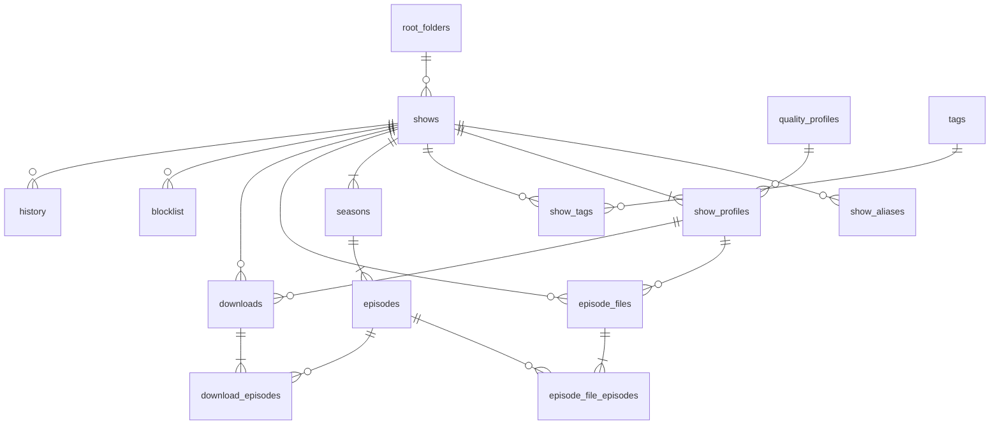
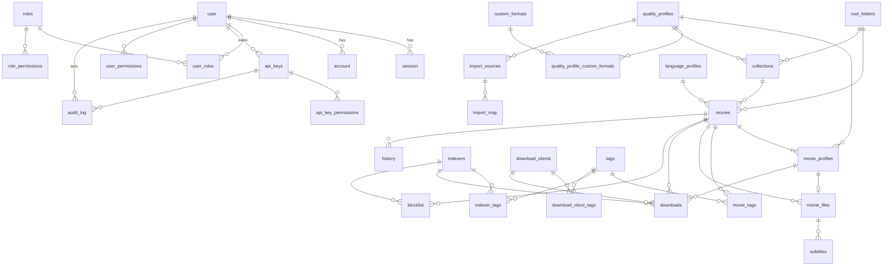

# 04 Database schema

Status: reviewed (2026-11-16). V1 tables, plus the TV tables designed below (M7),
which their issue creates, and the subtitle tables (M10), which migration `m0010`
creates. Usenet tables come with their milestone.

## Rules

- SQLite, one file, WAL mode, `foreign_keys = ON`.
- SeaORM 2 entities in `crates/db`. Schema changes are versioned migrations
  with `sea-orm-migration`, run at startup. No automatic schema sync outside
  local development.
- Auth tables and app tables are migrated together by our migrator.
- Primary keys of app tables: `INTEGER PRIMARY KEY`. The compat API needs
  integer ids.
- Timestamps: UTC, ISO 8601 text.
- A foreign key without a stated action is `restrict`: the referenced row
  cannot be deleted while it is in use. `cascade` and `set null` are written
  out in the tables below.
- Secret columns (marked "secret" below) hold ciphertext, never plain text.
  See [11-security.md](11-security.md) and ADR 0011.
- Structured values that are always read and written as a whole (quality
  profile items, custom format conditions, indexer categories) are JSON
  columns inside the database. Anything another table points at is a real
  table with foreign keys.
- Drop from entities to raw SQL only for: bulk upserts during import, FTS,
  and reports that need window functions. Keep raw SQL inside `crates/db`.

## Auth tables (generated)

Generated by `better-auth-rs generate` into `crates/db/src/auth_schema.rs`.
Marked **generated**: do not edit by hand, do not rename tables or columns.

Rule for changes: regenerate the file with `just gen-auth`, then write one of
our own migrations that applies the difference. `create_auth_tables` runs only
in the first migration; it fails if tables exist and never alters them.

The columns below are copied from the schema that `better-auth-rs generate`
(1.0.0-alpha.5, SQLite, default options) created in the M0 spike. Every
column is `NOT NULL` unless marked null. `date` is the declared SQLite type
of the timestamp columns.

Checked on 2026-11-16 against the `CREATE TABLE` statements of a database
that migration `m0001_init` created: tables, columns, nullability, keys and
indexes are the same. One difference inside the generated Rust file: the
entity field `user.email` is `Option<String>`, while the column is
`NOT NULL`.

| Table | Columns | Keys and constraints |
|---|---|---|
| `user` | `id` text PK, `name` text, `email` text, `emailVerified` integer, `image` text null, `createdAt` date, `updatedAt` date | unique(`email`) |
| `session` | `id` text PK, `expiresAt` date, `token` text, `createdAt` date, `updatedAt` date, `ipAddress` text null, `userAgent` text null, `userId` text FK user cascade | unique(`token`); index `session_userId_idx`(`userId`) |
| `account` | `id` text PK, `accountId` text, `providerId` text, `userId` text FK user cascade, `accessToken` text null, `refreshToken` text null, `idToken` text null, `accessTokenExpiresAt` date null, `refreshTokenExpiresAt` date null, `scope` text null, `password` text null (hash), `createdAt` date, `updatedAt` date | index `account_userId_idx`(`userId`) |
| `verification` | `id` text PK, `identifier` text, `value` text, `expiresAt` date, `createdAt` date, `updatedAt` date | index `verification_identifier_idx`(`identifier`) |

App columns added to `user` (allowed on the four core entities):
`disabled` bool not null default false, added by migration
`m0002_access_control`.

An app column is not added to the generated entity. Regenerating
`auth_schema.rs` with the column would also put it into
`create_auth_tables`, and that changes what the released first migration
creates. The column has a default instead, so the auth library, which does
not name it in its inserts, still works; our code reads and writes it with
its own queries.

## Access control tables

| Table | Columns | Keys and constraints |
|---|---|---|
| `roles` | `id` int PK, `name` text, `description` text null, `is_owner` bool default false, `created_at`, `updated_at` | unique(`name`); partial unique index where `is_owner` = 1 |
| `role_permissions` | `role_id` int FK roles cascade, `permission` text | PK(`role_id`, `permission`) |
| `user_roles` | `user_id` text FK user cascade, `role_id` int FK roles cascade, `all_libraries` bool default true | PK(`user_id`, `role_id`); index(`role_id`) |
| `user_role_libraries` | `user_id` text, `role_id` int, `library_id` int FK libraries cascade | PK(`user_id`, `role_id`, `library_id`); FK(`user_id`, `role_id`) to `user_roles` cascade; index(`library_id`) |
| `user_permissions` | `user_id` text FK user cascade, `permission` text, `all_libraries` bool default true | PK(`user_id`, `permission`) |
| `user_permission_libraries` | `user_id` text, `permission` text, `library_id` int FK libraries cascade | PK(`user_id`, `permission`, `library_id`); FK(`user_id`, `permission`) to `user_permissions` cascade; index(`library_id`) |
| `audit_log` | `id` int PK, `created_at`, `actor_user_id` text null FK user set null, `actor_name` text, `api_key_id` int null FK api_keys set null, `action` text, `target_kind` text null, `target_id` text null, `data` json null (never secrets), `ip_address` null | index(`created_at`); index(`actor_user_id`); index(`target_kind`, `target_id`) |
| `api_keys` | `id` int PK, `user_id` text FK user cascade, `name`, `key_hash` text, `key_prefix` text, `last_used_at` null, `created_at`, `revoked_at` null | unique(`key_hash`); index(`user_id`) |
| `api_key_permissions` | `api_key_id` int FK api_keys cascade, `permission` text | PK(`api_key_id`, `permission`) |

The Owner role has no rows in `role_permissions`. `is_owner` means "every
permission in the catalog". Unknown permission strings in the database are
ignored at load time. `user_permissions` holds direct grants; a user's
effective permissions are the union of their roles and their direct grants.

`audit_log` is append-only. `actor_name` is copied at write time so a row
stays readable after the user is deleted.

API keys use our own tables, not the Better Auth API-key plugin. The plugin
works, but it writes on every verification, uses text ids and has another
permission shape (ADR 0006, check 5).

## Library tables

| Table | Columns | Keys and constraints |
|---|---|---|
| `libraries` | `id` int PK, `name` text, `created_at`, `updated_at` | unique(`name`); seeded with `Default` by `m0015_libraries` |
| `root_folders` | `id` int PK, `path` text, `library_id` int FK libraries restrict, `created_at` | unique(`path`); index(`library_id`) |
| `quality_profiles` | `id` int PK, `name`, `upgrade_allowed` bool, `cutoff_quality_id` int, `items` json (ordered qualities and groups, allowed flag), `language` text default `any`, `min_format_score` int default 0, `cutoff_format_score` int default 0, `min_upgrade_format_score` int default 1, `trash_id` text null, `created_at`, `updated_at` | unique(`name`) |
| `quality_definitions` | `quality_id` int PK, `title` text, `min_size` real, `preferred_size` real null, `max_size` real null (megabytes per minute) | seeded with Radarr's defaults |
| `custom_formats` | `id` int PK, `name`, `include_when_renaming` bool default false, `specifications` json (conditions, Radarr's format), `trash_id` text null, `trash_synced` bool default false, `created_at`, `updated_at` | unique(`name`); unique(`trash_id`) |
| `quality_profile_custom_formats` | `quality_profile_id` int FK cascade, `custom_format_id` int FK cascade, `score` int | PK(`quality_profile_id`, `custom_format_id`) |
| `collections` | `id` int PK, `tmdb_id` int, `title`, `sort_title`, `overview` null, `poster_path` null, `monitored` bool default false, `root_folder_id` int null FK set null, `quality_profile_id` int null FK set null, `minimum_availability` text, `added_at`, `updated_at` | unique(`tmdb_id`) |
| `tags` | `id` int PK, `label` text | unique(`label`) |
| `movies` | `id` int PK, `tmdb_id` int, `imdb_id` text null, `title`, `original_title` null, `sort_title`, `year` int, `overview` null, `runtime` int null, `status` text, `in_cinemas` null, `digital_release` null, `physical_release` null, `poster_path` null, `collection_id` int null FK set null, `root_folder_id` int FK, `folder_name` text, `monitored` bool, `minimum_availability` text, `added_at`, `updated_at` | unique(`tmdb_id`); index(`root_folder_id`); index(`collection_id`) |
| `movie_profiles` | `id` int PK, `movie_id` int FK cascade, `quality_profile_id` int FK restrict, `is_primary` bool, `created_at` | unique(`movie_id`, `quality_profile_id`); partial unique(`movie_id`) where `is_primary` = 1; index(`quality_profile_id`) |
| `movie_tags` | `movie_id` FK cascade, `tag_id` FK cascade | PK(`movie_id`, `tag_id`); index(`tag_id`) |
| `movie_files` | `id` int PK, `movie_id` int FK cascade, `relative_path` text, `size` int, `quality_id` int, `release_group` null, `edition` null, `scene_name` null, `media_info` json null, `languages` json null, `movie_profile_id` int null FK set null, `added_at` | unique(`movie_profile_id`); unique(`movie_id`, `relative_path`) |

Qualities are a Rust enum in `core` with fixed ids, not a table. Their size
limits are rows in `quality_definitions`.

A movie has one row in `movie_profiles` per attached quality profile. A file
with `movie_profile_id` set is the managed file of that profile. A file with
`movie_profile_id` null is unmanaged: listed, never upgraded or deleted
automatically. SQLite allows several nulls in a unique index, so one movie
can have several unmanaged files.

Collections created from a monitored collection carry the defaults (root
folder, quality profile, minimum availability) for movies added from it.

## Search and download tables

| Table | Columns | Keys and constraints |
|---|---|---|
| `indexers` | `id` int PK, `name`, `kind` text (`torznab`), `url`, `api_key` text (secret), `categories` json, `priority` int default 25, `use_proxy` bool default true, `enabled` bool, `created_at` | unique(`name`) |
| `indexer_tags` | `indexer_id` FK cascade, `tag_id` FK cascade | PK(`indexer_id`, `tag_id`); index(`tag_id`) |
| `download_clients` | `id` int PK, `name`, `kind` text (`qbittorrent`, `sabnzbd`), `url`, `username` null, `password` null (secret), `api_key` null (secret; required for sabnzbd), `category` text, `remote_path` text null, `local_path` text null, `remove_completed` bool default false, `enabled` bool, `created_at` | unique(`name`) |
| `download_client_tags` | `download_client_id` FK cascade, `tag_id` FK cascade | PK(`download_client_id`, `tag_id`); index(`tag_id`) |
| `downloads` | `id` int PK, `movie_id` int FK cascade, `movie_profile_id` int null FK set null, `indexer_id` int null FK set null, `download_client_id` int null FK set null, `client_download_id` text (torrent hash), `release_title`, `quality_id` int, `custom_format_score` int default 0, `size` int, `state` text, `error` null, `attempts` int default 0, `grabbed_at`, `completed_at` null, `imported_at` null | unique(`download_client_id`, `client_download_id`); index(`state`); index(`movie_id`) |
| `blocklist` | `id` int PK, `movie_id` int FK cascade, `release_title`, `indexer_id` int null FK set null, `reason`, `created_at` | index(`movie_id`) |
| `history` | `id` int PK, `movie_id` int null FK set null, `event` text, `data` json, `created_at` | index(`movie_id`, `created_at`) |

Deleting a movie deletes its download rows. Deleting a download client keeps
its download rows as history, with `download_client_id` null; the API refuses
the delete while one of its downloads is still active.

Tag rule, as in Radarr: an indexer or download client without tags is used
for every movie. With tags, it is used only for movies that share at least
one tag.

A download client's remote path mapping is `remote_path` (the folder as the
client sees it) and `local_path` (the same folder as Unseenarr sees it). Both are
set or both are null.

## Subtitle tables (M10)

Designed in the subtitles design. Created by migration `m0010_subtitles`.

| Table | Columns | Keys and constraints |
|---|---|---|
| `language_profiles` | `id` int PK, `name` text, `items` json (ordered list of `{ language, kind }`; `kind` is `normal`, `hi` or `forced`), `cutoff` int null (index into `items`), `created_at`, `updated_at` | unique(`name`) |
| `subtitles` | `id` int PK, `movie_file_id` int FK cascade, `language` text (`en`, `pt-BR`), `kind` text (`normal`, `hi`, `forced`), `relative_path` text, `provider` text null (`opensubtitles`; null for a file that was imported or added by the user), `provider_id` text null (the provider's file id), `score` int null, `added_at` | unique(`movie_file_id`, `language`, `kind`); index(`movie_file_id`) |

`movies` gets `language_profile_id` int null FK `language_profiles`
(restrict: a profile that a movie uses cannot be deleted). A null value means
no subtitles are wanted for the movie.

`language_profiles.items` is a JSON column for the reason given in the
decisions: it is always read and written as one ordered list and nothing
points at an item. `subtitles.language` is a lower case ISO 639-1 code, with
an upper case region (`pt-BR`, `zh-CN`) only where the provider and media
servers distinguish the variants.

The OpenSubtitles download quota is not a table: the last answer of the
provider is kept in `settings` under `subtitles.opensubtitles.quota`
(see [08-integrations.md](08-integrations.md)).

Episode subtitles: `subtitles` also has `episode_file_id` (see
[TV tables](#tv-tables-m7)). Both file columns are nullable and exactly one
is set; unique(`episode_file_id`, `language`, `kind`) sits next to the movie
key.

## TV tables (M7)

Designed in the TV design. Created by #86, not before. The shape follows the
movie tables, and the same rules apply (integer keys, `restrict` unless
stated). The model is in [03-domain-model.md](03-domain-model.md#tv-m7).

| Table | Columns | Keys and constraints |
|---|---|---|
| `shows` | `id` int PK, `tvdb_id` int null, `tmdb_id` int null, `imdb_id` text null, `metadata_provider` text (`tvdb`, `tmdb`: the numbering provider), `title`, `original_title` null, `sort_title`, `year` int, `overview` null, `runtime` int null (minutes per episode), `status` text (`continuing`, `ended`, `upcoming`), `series_type` text (`standard`, `daily`, `anime`), `network` null, `poster_path` null, `season_folder` bool default true, `root_folder_id` int FK, `folder_name` text, `monitored` bool, `monitor_new_items` text (`all`, `none`) default `all`, `refreshed_at` null, `added_at`, `updated_at` | unique(`tvdb_id`); unique(`tmdb_id`); check `tvdb_id` or `tmdb_id` is not null; index(`root_folder_id`) |
| `show_aliases` | `id` int PK, `show_id` int FK cascade, `title` text | unique(`show_id`, `title`) |
| `show_profiles` | `id` int PK, `show_id` int FK cascade, `quality_profile_id` int FK restrict, `is_primary` bool, `created_at` | unique(`show_id`, `quality_profile_id`); partial unique(`show_id`) where `is_primary` = 1; index(`quality_profile_id`) |
| `show_tags` | `show_id` FK cascade, `tag_id` FK cascade | PK(`show_id`, `tag_id`); index(`tag_id`) |
| `seasons` | `show_id` int FK cascade, `season_number` int (0 is the specials), `monitored` bool | PK(`show_id`, `season_number`) |
| `episodes` | `id` int PK, `show_id` int, `season_number` int, `episode_number` int, `absolute_number` int null, `title`, `overview` null, `air_date` text null (date), `air_date_utc` null, `runtime` int null, `tvdb_id` int null, `tmdb_id` int null, `monitored` bool, `added_at`, `updated_at` | unique(`show_id`, `season_number`, `episode_number`); FK(`show_id`, `season_number`) to `seasons` cascade; unique(`tvdb_id`); unique(`tmdb_id`); index(`air_date`); index(`show_id`, `absolute_number`) |
| `episode_files` | `id` int PK, `show_id` int FK cascade, `relative_path` text (from the show folder, for example `Season 1/Show - S01E01 - Title WEBDL-1080p.mkv`), `size` int, `quality_id` int, `release_group` null, `scene_name` null, `media_info` json null, `languages` json null, `show_profile_id` int null FK set null, `added_at` | unique(`show_id`, `relative_path`); index(`show_profile_id`) |
| `episode_file_episodes` | `episode_file_id` int FK cascade, `episode_id` int FK cascade | PK(`episode_file_id`, `episode_id`); index(`episode_id`) |
| `download_episodes` | `download_id` int FK cascade, `episode_id` int FK cascade | PK(`download_id`, `episode_id`); index(`episode_id`) |

Notes:

- An episode file covers one or more episodes through `episode_file_episodes`
  (a multi-episode release is one file). An episode can have several files:
  one per show profile, plus unmanaged ones. A file with `show_profile_id` set
  is the managed file of that profile for every episode it covers. A null
  value means unmanaged, as with `movie_files.movie_profile_id`.
- "At most one managed file per episode and show profile" cannot be a
  constraint in SQLite, because the profile is on the file and the episode is
  on the link table. The import writes both in one transaction, and a
  database test checks the rule.
- `episodes.air_date` is the date the provider gives; daily shows are matched
  on it. `air_date_utc` is the moment, when the provider has one. The domain
  model defines when an episode counts as aired.
- `absolute_number` is nullable and not unique: providers repeat numbers for
  specials. Numbering rules for anime beyond this column come with #90.
- `seasons` has no integer id: Sonarr's API addresses a season by its number
  inside the series, and nothing else points at a season row.
- A show has no `quality_profile_id`: its profiles are in `show_profiles`.
  The compat API shows the primary one.
- Deleting a show deletes its seasons, episodes, episode file rows, link rows
  and download rows. It never deletes files on disk. Deleting a show profile
  sets `episode_files.show_profile_id` to null: the files become unmanaged.
- Subtitles: the subtitle migration (#105) runs after this one. It creates
  `subtitles` with both `movie_file_id` and `episode_file_id` (each int null,
  FK cascade, exactly one set) and adds `shows.language_profile_id`
  (int null FK `language_profiles`, restrict), as it does for movies.

### Changes to existing tables

The TV migration also changes tables that exist from V1. Existing rows keep
their meaning: each new column defaults to the movie value.

| Table | Change |
|---|---|
| `root_folders` | Add `media_kind` text (`movie`, `show`) default `movie`. A root folder holds one kind, which cannot change while a movie or show uses the folder |
| `quality_profiles` | Add `media_kind` default `movie`. Replace unique(`name`) with unique(`media_kind`, `name`), so a Sonarr and a Radarr profile can both be called `HD-1080p` |
| `quality_definitions` | Add `media_kind` default `movie`. The key becomes PK(`media_kind`, `quality_id`). The `show` rows are seeded from Sonarr's defaults |
| `custom_formats` | Add `media_kind` default `movie`. Replace unique(`name`) with unique(`media_kind`, `name`). A profile scores only formats of its own kind |
| `trash_guide_items` | Add `media_kind` default `movie`. The TRaSH data for Sonarr loads as `show` |
| `indexers` | Add `tv_categories` json default `[]`: the Torznab categories for shows, for example 5000. An empty list means the indexer is not searched for shows |
| `downloads` | `movie_id` becomes nullable. Add `show_id` int null FK cascade and `show_profile_id` int null FK set null. Check: exactly one of `movie_id` and `show_id` is set. Add index(`show_id`). The episodes of a download are in `download_episodes`: one row for an episode release, many for a multi-episode release or a season pack |
| `blocklist` | `movie_id` becomes nullable. Add `show_id` int null FK cascade. Check: exactly one of the two is set. Add index(`show_id`) |
| `history` | Add `show_id` int null FK set null and `episode_id` int null FK set null. Add index(`show_id`, `created_at`) |

SQLite cannot drop `NOT NULL` or add a `CHECK` to an existing table. The
migration rebuilds `downloads` and `blocklist`: create the new table, copy the
rows, drop the old table, rename the new one, recreate the indexes. It runs
with foreign keys off and ends with a foreign key check. A database test
applies the migration to a database that holds V1 movies, downloads and
history, and compares the rows before and after.

The blocklist is per show: a blocked release title is skipped for that show,
whatever episodes the release covers.

## System tables

| Table | Columns | Keys |
|---|---|---|
| `settings` | `key` text PK, `value` json, `updated_at` | |
| `scheduled_tasks` | `name` text PK, `interval_seconds` int, `last_run_at` null, `last_status` null, `last_error` null | |
| `import_sources` | `id` int PK, `kind` text (`radarr` or `prowlarr`), `name`, `url`, `api_key` (secret), `target_quality_profile_id` int null FK set null, `remote_path` null, `local_path` null, `last_import_at` null, `created_at`, `updated_at` | unique(`url`), both path columns set or both null |
| `trash_guide_items` | `id` int PK, `kind` text (`custom_format`, `cf_group`, `quality_profile`, `quality_size`), `trash_id` text, `name`, `data` json, `guide_commit` text, `updated_at` | unique(`kind`, `trash_id`) |
| `import_map` | `source_id` int FK cascade, `resource` text, `source_resource_id` int, `local_id` int | PK(`source_id`, `resource`, `source_resource_id`) |

`import_map` makes instance import safe to re-run. `trash_guide_items` is a
local copy of the published TRaSH guide data; it can be rebuilt at any time.

## ER diagram

Not in the diagram, because no foreign key touches them: `verification`,
`quality_definitions`, `settings`, `scheduled_tasks`, `trash_guide_items`.

## Decisions (2026-11-15)

- Secrets are encrypted at rest.
- `quality_profiles.items` is a JSON column in the database. It is always
  read and written as one ordered list, and Radarr's API uses the same
  shape. Custom format scores are a child table because they point at
  `custom_formats`.
- Tags apply to indexers and download clients in V1.
- One movie can have several files (`movie_profiles`). Collections,
  custom formats, quality definitions, direct grants and the audit log have
  tables in V1.

## Open questions

- Retention of `audit_log` and `history` rows: keep forever, or prune by age.
  Kept open on purpose: nothing writes these rows before M1 (`audit_log`)
  and M4 (`history`). The audit log issue (#116) decides for `audit_log`;
  pruning can be added later without a schema change.
